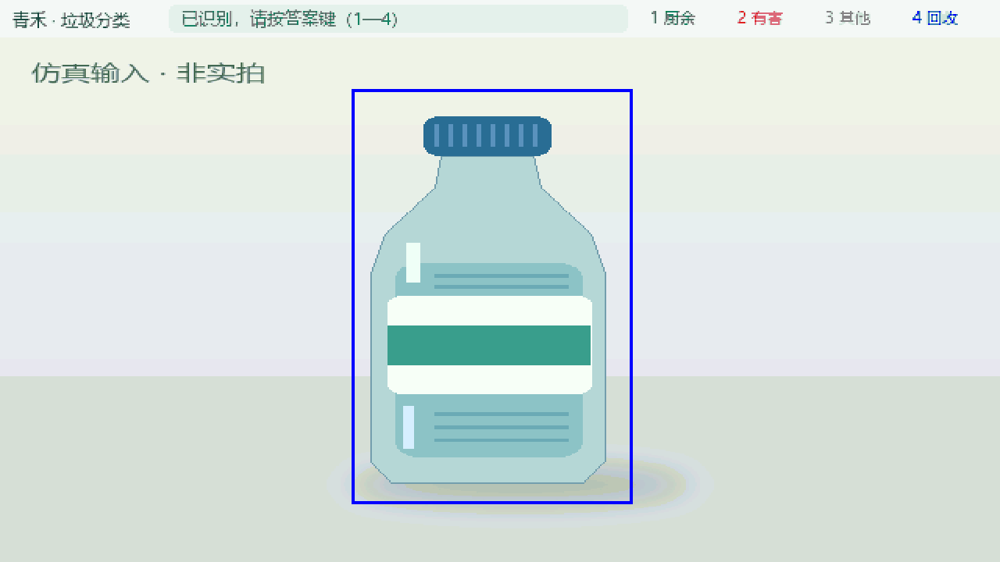

# 四桶颜色与独立状态栏：实现与上板记录

用户最初要求先修改、验证，保留等待放物品、已识别请按键、按键后反馈等状态。11月12日追加授权后，已完成源码、资产、RTL仿真和完整物理实现，新界面位流已实际SRAM下载。此次保持原模型，四桶新模型仍是离线候选；画面、语音和机构需与工具验证分开验收。

## 11月12日追加下载授权

用户随后明确要求一边评估个人实拍照片，一边将此前界面修改下载到板上，模型暂不升级。已启动新冻结完整实现，保留旧六通道模型、固件、FOUR_BIN_CLASSES=0及已验收舵机校准；下载前仍执行镜像/容量/预算和最终多角STA门禁。

有效实现为`trash_status48_20261112_004`，SHA256 `25f22997ed94facc95b58f1759fc0fbe60b3ac5a8b9335871b203078d71b4fbb`。最终多角Setup/Hold/Recovery/Removal/Minimum Pulse Width全部通过；最差慢角Setup 0.212 ns、慢角Hold 0.275 ns、快角Hold 0.184 ns。最终布线资源28491 LUT、22071 FF、290 LUTRAM、132.5 DRM、123 APM、141 IO，均在器件容量及完整应用预算内。资源取同轮`.prr`的CLMA与CLMS合计，复用布局时原始summary的Device Map字段为NA，因此保留原表，另存实际布线资源CSV并执行面积门禁。证据见`evidence/records/optimization/trash_status48_20261112_004/`。

001因摄像头快照RAM两个setup端点失败、002因DDR响应FIFO hold端点失败均未生成或下载。004复用002的冻结映射/放置，将数据hold修复目标由200提高至400 ps，clock路径目标仍为200 ps；不修改功能RTL、固件或模型。各轮原始失败报告单独留证，不能当作交付时序。

实际下载记录见`evidence/records/trash-status48-20261112-program-002/`：`program=1`，即时及5秒状态均为`081ffca0`，正常`disconnect=1`，新固件COM34回复通过。首次记录program-001已下载，但主机环境缺串口库中止恢复；002使用已安装pyserial的Python完成后续操作。原模型加载/CRC/自动识别完成状态以002的`result.json`为准，不把只读扫描当作下载证明。

002后续已完成：原模型1863560字节加载用时186.563秒，设备CRC `0x3a4a5d5d`通过；摄像头单次推理请求3.750秒返回成功，开启自动模式后收到首帧。这两次检测列表均为空，只证明推理/协议可运行，不证明具体物品已被识别，也不是平均测速。发布目录`project/trash_sorting/bitstream/full_27mhz/`已更新为同SHA位流，旧manifest保存在002的`superseded-manifest.json`。用户于2026-11-12回复“正常，文字不挡画面”，确认本版状态栏与摄像头画面显示正常，界面现场验收通过。该回复仅确认显示，不扩展为本版语音及机构重新验收。

## 界面

顶部状态栏由112行缩为48行，删除宣传语，保留简短标题、动态状态和1绿厨余/2红有害/3灰其他/4蓝回收按键图例。下方1280×672是独立摄像头区域，状态文字不与视频共用像素。

这不是简单覆盖源图前48行：顶层只在屏幕y48..719发出视频读请求，DDR读侧把完整720行视野缩采样为672行；目的行d对应源行`floor(d*719/671)`。源首行0和末行719都显示。水平保持1:1，纵向压缩约6.7%，无新增帧/行缓存。实现使用常数步长和余数累加，避免动态除法。推理快照仍覆盖完整1280×720，CPU原框坐标不变，OSD使用同一源行映射，框随图像同步压缩。

状态保留等待放入、已识别请按1—4答案键、投放提示、音频状态、异常提示、答对/答错结果。其中答错提示明确仍打开正确桶。背景ROM从4480缩至1920个32bit字，状态ROM仍为4860字。舵机和答题控制器未在本轮修改。

这是实际RTL输出的预览：摄像头输入为已有的人工瓶子测试图，蓝框由测试台手动注入，不是新模型推理或板上拍摄。“仿真输入·非实拍”原本就在源图顶部，现在完整出现在状态栏下面，没有被状态栏盖住。

## 类别、颜色与部署边界

新训练候选本身只有四个桶类别，不输出纸张/纸板/陶瓷等细分物品名。训练覆盖与准确率的完整来源见[重训记录](trash-retraining-20261111.md)。物品清单表示训练覆盖，不表示同类所有外形均能可靠识别。

| 新模型ID | 类别 | 框色RGB565 | 业务桶码/答案键 | 主要训练覆盖 |
| --- | --- | --- | --- | --- |
| 0 | 厨余 | 07e0 绿 | 1 | 生物垃圾、果蔬，含胡萝卜/土豆/白萝卜/土豆片 |
| 1 | 可回收 | 001f 蓝 | 4 | 纸张和纸板合并、玻璃、金属、塑料、瓶、罐、纸杯 |
| 2 | 有害 | f800 红 | 2 | 电池、药丸/药板 |
| 3 | 其他 | 8410 灰 | 3 | 陶瓷、砖块、石头及部分其他杂物 |

`FOUR_BIN_CLASSES`由portable顶层统一传给OSD和业务映射。1表示上表四类；0保留当前六通道旧模型语义（0绿，1..5蓝）。顶层仍为0，因为当前固件/量化权重尚未切换到四类27通道；不能把旧glass(ID2)或metal(ID3)误解为红/灰。显示物品文字已关闭，两种模式都不再按材料使用额外框色。未知8位ID不绘框、不映射桶，不能截成低3位后冒充有效类别。

四类浮点候选已训练完成，但量化、打包、网络头/固件配套及板上校验仍待后续集成。此次已下载显示和映射接口，保持旧六通道模式，不能宣称红/灰新模型已在板上识别。

## 验证与证据

入口：`project/trash_sorting/tools/test_four_bin_display.py`（只调用ModelSim，不含PDS或下载操作），以及`source/extensions/business/application/tests/test_light_ui_assets.py`。

- 当前portable顶层及修改RTL编译通过。
- 两种类别模式各遍历全部256个ID，核对有效颜色与业务桶码、拒绝非法ID，遍历原文字区域验证只透传摄像头像素。
- 原OSD慢推理保持、空结果TTL、重复空结果不刷新、有效结果恢复和帧边界替换通过；CPU提交/忙时拒绝/空结果/类别优先级回归通过。
- 真实sync_vg、rd_buf、frontend、ui_light_panel与light_split_video联合仿真。仅厂商双口RAM用等接口行为模型、DDR响应由测试台提供，不是完整DDR PHY或上板测试。
- 两个完整帧共1,843,200像素逐点比对，1344条读行命令，源行0..719地址、输出像素、每行OSD源坐标、可变DDR首拍延迟/数据间隙、读有效区域、消隐和RGB/同步延迟均通过。第二帧修改像素数据，验证没有停留在旧帧。
- 全部9种状态图元、文字颜色、ROM边界及合成器两拍同步/栏边界通过。ModelSim旧版本输出过临时目录权限警告，各例均有明确PASS及零仿真错误，日志保留。
- 资产生成、ROM长度、完整源区与目标区布局检查通过。

仿真日志、源/资产哈希和当时发布身份在`evidence/records/trash-display-20261111-001/`。本次实际物理实现与下载证据见上文；仿真不替代最终多角STA或实物验收。
