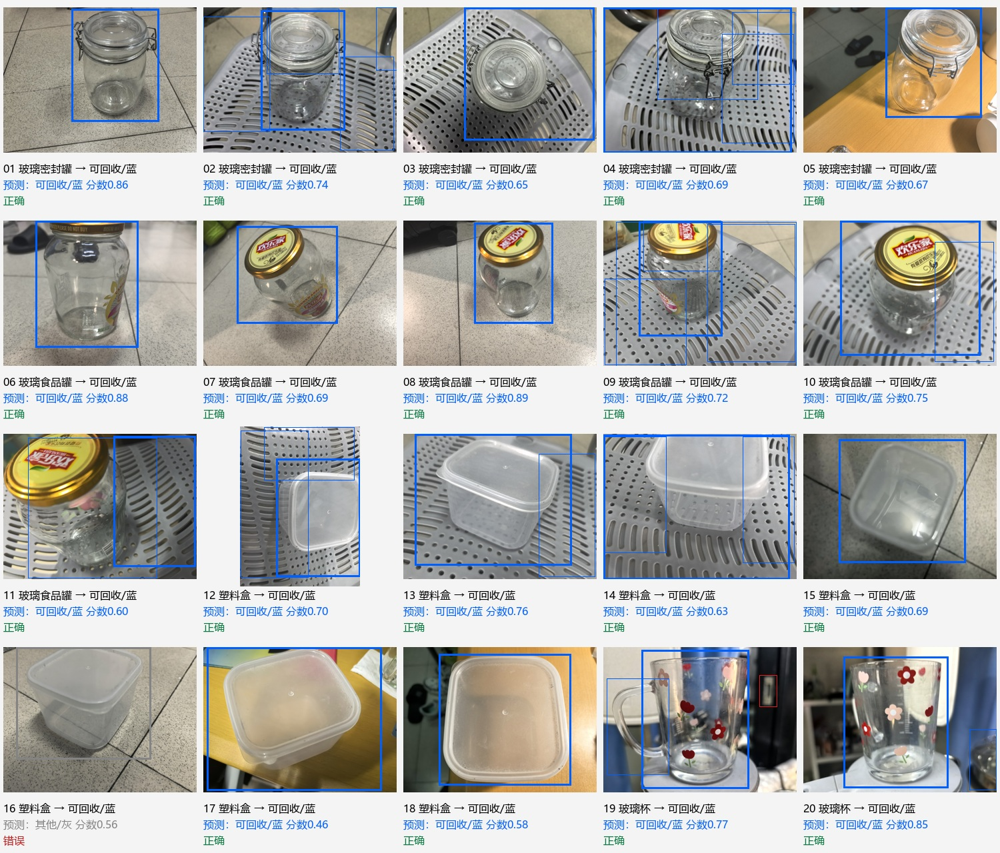
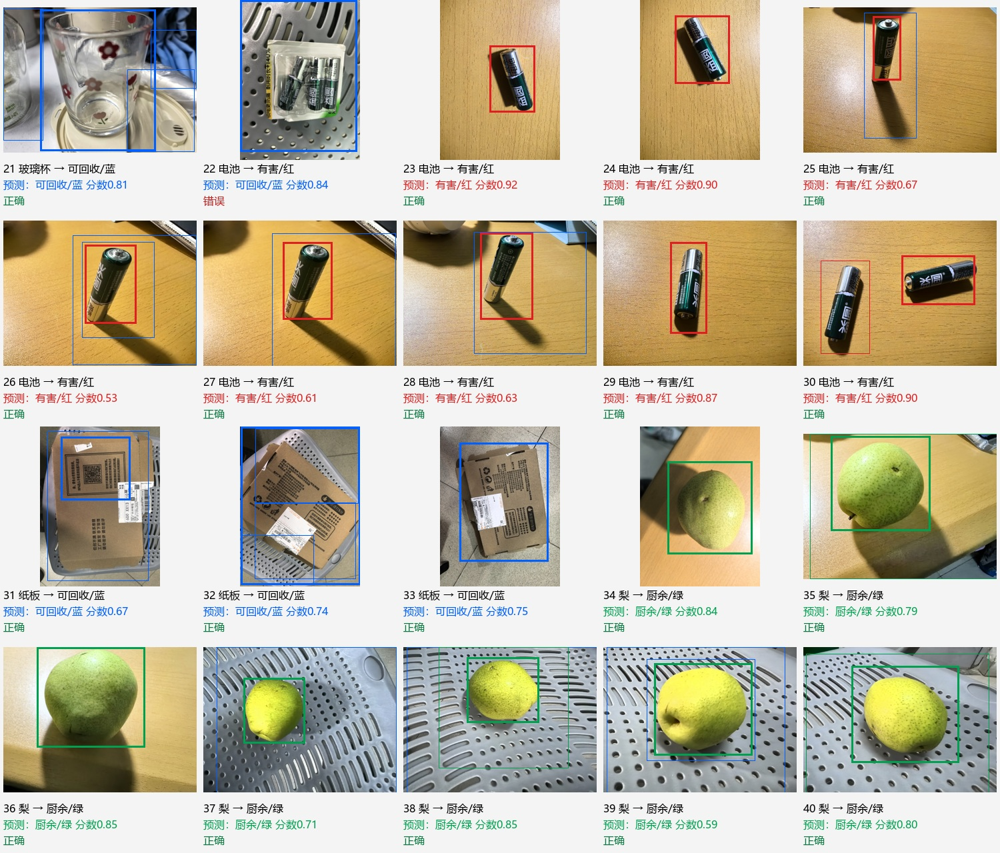
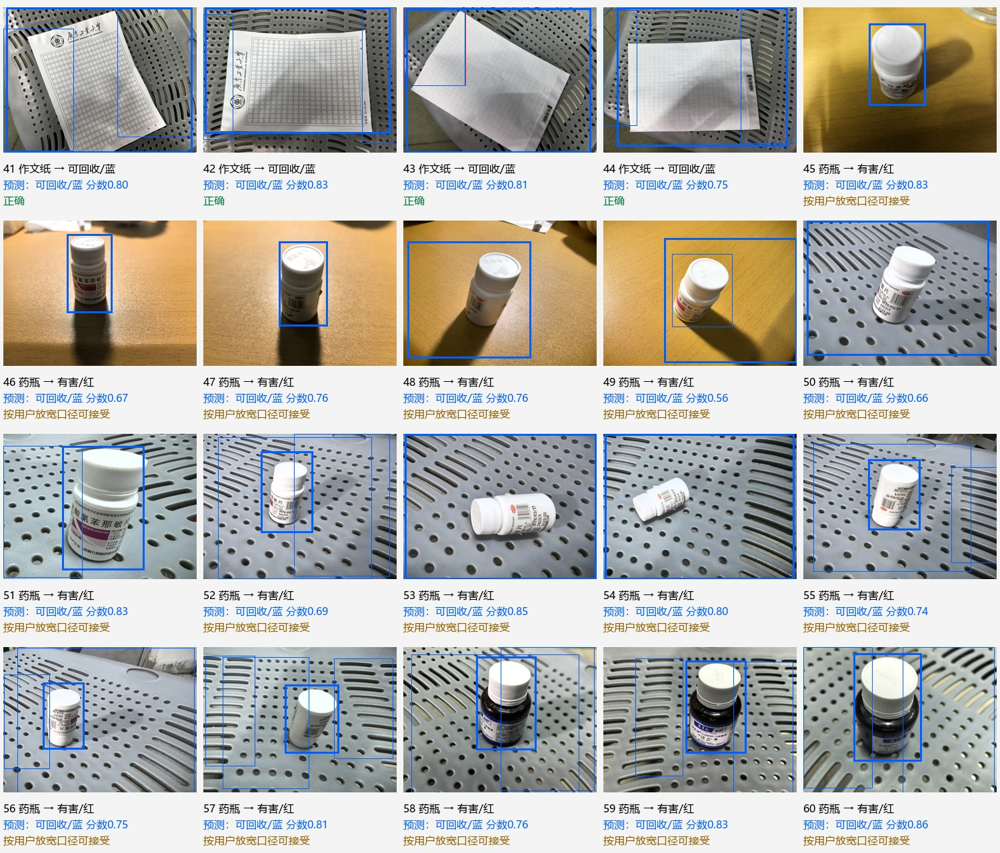
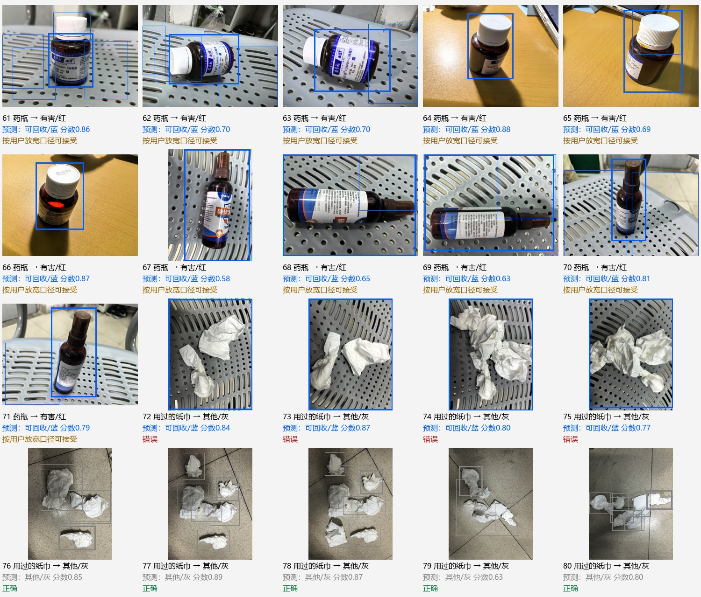

# 用户实拍80张：四桶候选离线评估

## 测试条件

读取`D:/Huawei Share/Huawei Share`全部80张JPG，未修改、移动或重新编码原图。文件夹另有PDF，不作模型输入。图片解码成功，原始文件SHA256均不同，校正EXIF方向后分辨率从3072×4096至5824×4368，包含横图和竖图。

先独立查看全部四张联系表，再固定每张图的主要被拍摄物及目标桶，之后才运行模型。真值没有根据预测修正。当前候选为`four_bins_yolov5n_320.pt`，SHA256 `8014832f2bc87081c9a7adad363d5590c13ffc6b4c8ff6700f289553b1f575e0`。CPU/PyTorch浮点推理，EXIF矫正、保持比例letterbox到320×320，置信度0.25、NMS IoU0.45、逐候选单类别；每图取最高分框的桶与主要目标桶比较，漏检算错。

所有80张都只用于这次测试，未加入训练。照片包含同一批实物的连续角度/背景变化，不能把80张当成80个独立新实物，也不能推断总体实物准确率。未人工标检测框，因此不计算mAP、框召回率或定位准确率。最高分框落到背景上时，桶色恰好一致仍可能得到图片选桶一致，不能解释为目标被正确定位。本测试也不等同FPGA INT8/720p摄像头结果。

## 结果

| 被拍摄物 | 图片数 | 目标 | 严格选桶一致 | 实际输出 |
| --- | ---: | --- | ---: | --- |
| 玻璃密封罐、食品罐和玻璃杯 | 14 | 蓝 | 14/14，100% | 全蓝 |
| 塑料盒 | 7 | 蓝 | 6/7，85.7% | 6蓝、1灰 |
| 纸板 | 3 | 蓝 | 3/3，100% | 全蓝 |
| 作文纸 | 4 | 蓝 | 4/4，100% | 全蓝 |
| 电池 | 9 | 红 | 8/9，88.9% | 8红、1蓝 |
| 梨 | 7 | 绿 | 7/7，100% | 全绿 |
| 药瓶 | 27 | 严格红，用户亦接受蓝 | 0/27，0% | 全蓝；用户放宽口径27/27可接受 |
| 用过的纸巾 | 9 | 灰 | 5/9，55.6% | 5灰、4蓝 |

严格按药瓶应红统计：47/80=**58.75%**。仅药瓶允许红或蓝、其余规则保持不变：74/80=**92.5%**，这是用户接受口径，不能称严格四分类准确率。排除药瓶后其余53图为47/53=88.68%。80图均有检测输出，但有额外框和背景误报，不能据此称“物品零漏检”。

按严格目标桶统计：绿7/7，蓝27/28，红8/36（其中药瓶0/27），灰5/9。红桶合计较低是因为药瓶全部进蓝，单独电池8/9。电池统一按用户项目红桶约定评测，形状识别不判断电池化学类型。

## 具体失败与观察

- 编号16，`IMG_20261111_235552.jpg`：地砖上的透明塑料盒被分为灰，最高分约0.56。
- 编号22，`IMG_20261111_235718.jpg`：带包装的多节电池被分为蓝，约0.84；裸电池的8张均分红。一个包装样本不能证明所有包装电池都会失败。
- 编号45..71，27张不同药瓶均蓝，包括白色小药瓶、棕色药瓶及喷剂瓶。不能声称候选已经会把药瓶识别成有害垃圾。图片评分为桶标签，模型没有输出“塑料”或具体药名。
- 编号72..75，`IMG_20261112_000157/000159/000206/000208.jpg`：纸巾在灰色镂空椅背景下四图均蓝，约0.77..0.87；部分最高分框圈住大块椅面。编号76..80同类纸巾在地砖上五图均灰。两组结果提示背景依赖，需要更多场景/空背景负样本验证，不能仅凭这批断言因果。
- 若干玻璃/作文纸照片虽然最高桶为蓝，但额外蓝框落在椅子或周围物品上，有些最高框过大。图级选桶指标会掩盖这些定位问题。

优先改进应补拍用过纸巾在桌面、椅面、地面及不同光照下的目标框，同时采集相同场景的空背景作核实负样本；补带包装电池与透明盒。若希望药瓶分红，必须先统一药瓶标签策略，并补药瓶与普通日用品瓶子的区分数据。后续使用这些图微调后，本批应改称开发集；最终验收另拍新的实物/场次并按实物分组留出，避免把同一药瓶不同角度随机拆成训练和测试。

## 全部预测及复现

以下按文件顺序展示全部80图，没有挑成功例。粗框为最高分，细框为其他预测；图下分别标目标与模型输出。分数为模型置信度，不是准确率。

脚本`project/trash_sorting/training/evaluate_personal_photos.py`支持inventory/evaluate/report三步。证据目录`evidence/records/trash-personal-photos-20261112-001/`保存80张文件哈希与尺寸、预测前固定的truth、原始预测框/分数、矩阵、逐图CSV、配置和模型哈希。原始照片留在用户文件夹，未复制进仓库。
