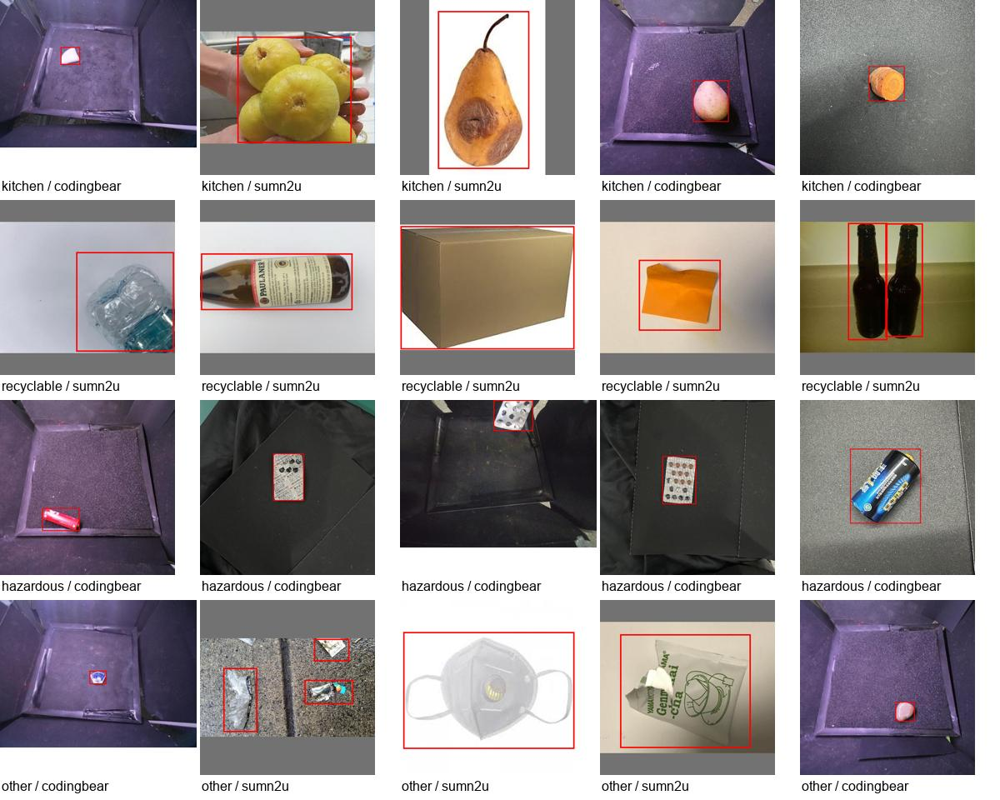
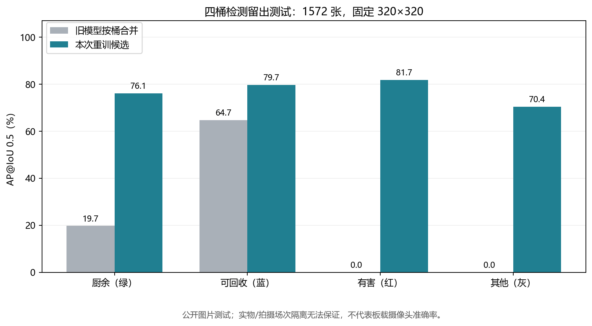
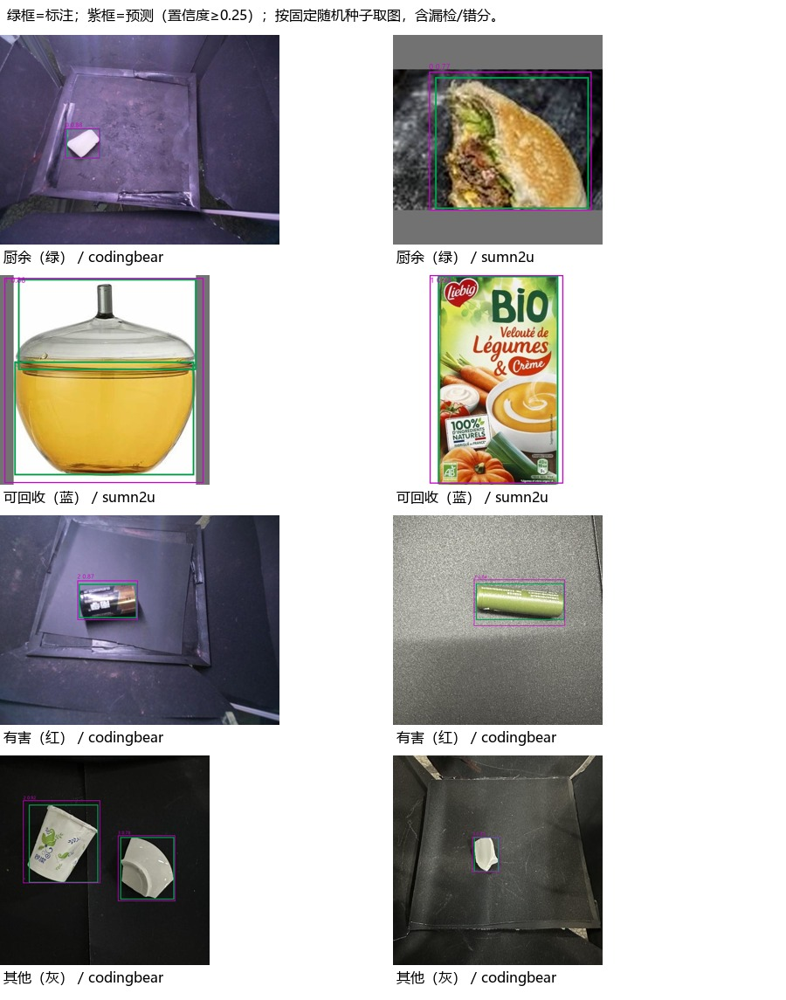
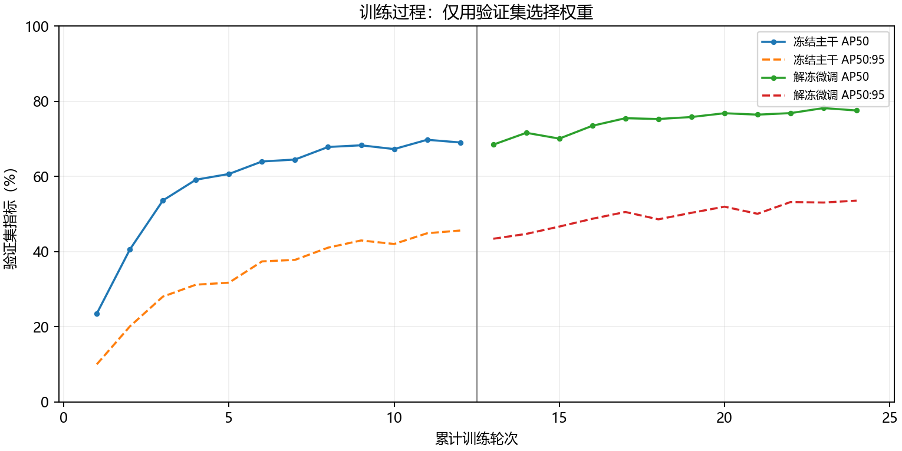

# 四桶检测重训记录

## 状态与范围

本轮已完成网上来源查找、实际图片/框抽查、10,383图的程序审计与分组划分、两阶段共24轮YOLOv5n训练和新旧模型的1572图留出测试。已产出浮点候选权重，尚未量化或替换FPGA发布。

候选模型直接检测四个桶类别：0厨余/绿、1可回收/蓝、2有害/红、3其他/灰。纸板和纸张合并到可回收，不再相互竞争。该候选不输出玻璃、塑料等细分物品名；与当前发布的六类原始模型、五个有效物品输出分开管理。当前实测正常的FPGA发布、舵机、答题和语音未替换。

当前业务桶码/按键顺序仍为1绿、2红、3灰、4蓝。新模型class 0/1/2/3应分别映射桶码1/4/2/3，不能直接class+1。该映射已写入候选类别定义和打包manifest，尚未应用于活动固件。

## 数据来源与实际检查

| 来源 | 实际内容 | 许可和选择理由 |
| --- | --- | --- |
| [CodingBearHsun trash-sort v1](https://www.kaggle.com/datasets/codingbearhsun/trash-sort) | 实际2221图，12类YOLO检测框；电池246框、药丸/药板146框，另有瓶、罐、纸杯、胡萝卜、土豆、白萝卜、土豆片、陶瓷、砖、石 | CC BY-NC-SA 4.0。适合本项目近距离物品演示；有害和其他类别可训练，但大量照片为少数固定背景/实物，泛化仍须实拍验收。原页面称2000图，以解压审计数为准 |
| [Suman Kunwar Garbage Classification v2 BBox 384 v1](https://www.kaggle.com/datasets/sumn2u/garbage-classification-v2-bbox-384) | 实际8162图，7类YOLO框；纸板、纸张、玻璃、金属、塑料、生物垃圾、其他；不含电池 | CC BY 4.0。补纸张纸箱、瓶罐、果蔬和日常其他垃圾的背景/外形变化。抽查发现金属托盘标成glass；本轮只使用桶级标签，玻璃/金属均映射蓝桶，未声称材料细分类标签可靠。图像采集与框标注的全部过程未由我们复核 |

两份数据混合及衍生候选需保留来源署名并遵守CC BY-NC-SA 4.0与CC BY 4.0的条款；其中非商业条件适用于第一个来源。此数据和候选权重不按商业用途发布。

实际样图和标注框：

这张图展示数据真值框，不是模型检测结果。已另外检查28张按原7类抽取的图片，保留[原标签抽查图](assets/trash-new-dataset-label-review.jpg)。抽样不能证明所有标签均正确。

未选作主训练源：Malaysian Trash Annotation虽有真实多设备、多场景图和COCO分割，但train中s-hazardous仅11框，valid无该类，不能单独承担四桶识别。Huawei相关公开镜像和若干名字含YOLO的数据实际只有整图分类目录；不生成假全图检测框。TACO的电池只有2框，不适合做主要电池训练集。网页元数据、原始类别数和下载归档SHA见`evidence/records/trash-retrain-20261111-001/`。

## 清洗、分组与划分

完整解码检查，不容忍截断JPEG；检测框要求类别有效、坐标有限、宽高为正且在图内。4张框越界图被剔除，13张空标注图片未作为“确认无物体”的负样本使用。没有发现相同像素图片的桶标签冲突。

相同解码像素SHA256与64位pHash距离≤4的近似重复图合为同组，再按来源和主要桶类分层，以固定seed 20261111划分。近重复2076条连接、9816个视觉组；训练/验证/测试组交集为空。只在训练集限制多数类规模，避免可回收压倒红桶。按全部合格图约70/15/15分组后，训练又采样，故最终图数比例并非70/15/15。

| 划分 | 图数 | 厨余框 | 可回收框 | 有害框 | 其他框 |
| --- | ---: | ---: | ---: | ---: | ---: |
| train | 1795 | 906 | 838 | 296 | 804 |
| val | 1508 | 314 | 1716 | 45 | 257 |
| test | 1572 | 351 | 1841 | 49 | 216 |

这些公共照片没有可靠的实物实例/拍摄场次ID。pHash只能阻止可检测的视觉近重复，不能保证同一实物不同角度全在同组；有害类实物和背景多样性尤其有限。测试结果只能称本轮公共图片留出集指标，不能称未见实物或本机摄像头准确率。旧预训练模型的完整训练成员不可核验，因此也不保证预训练阶段与这些网络图片完全无交集。

本项目候选把数据中电池形状归红桶，以覆盖用户要求的电池演示；这不代表所有化学类型电池在各地都应投入有害桶。图片无法证明药品是否过期。其他桶只覆盖已见陶瓷、砖石、日常杂物等，不能解释为自动认识所有未知垃圾。纸杯沿用数据的可回收定义，现场有污染或覆膜复合材质时应按实际规则补标。

## 已完成的留出测试结果

候选选择在测试前锁定：仅比较两阶段val fitness（0.1×AP50+0.9×AP50:95），选择解冻阶段best.pt；`selection.json`保存锁定时间、依据和哈希。两阶段分别约33.0与34.5分钟，共24轮、约67.5分钟CPU训练（不含数据准备和测试）。

| 类别 | test框数 | 旧模型AP50 | 重训AP50 | 重训AP50:95 |
| --- | ---: | ---: | ---: | ---: |
| 厨余/绿 | 351 | 19.7% | 76.1% | 50.8% |
| 可回收/蓝 | 1841 | 64.7% | 79.7% | 48.8% |
| 有害/红 | 49 | 0% | 81.7% | 54.4% |
| 其他/灰 | 216 | 0% | 70.4% | 44.3% |
| 四类宏平均 | 2457 | 21.1% | **77.0%** | **49.6%** |

旧模型宏平均AP50:95为11.9%。此比较把新增加的红/灰两类也纳入四类平均，不能把55.9个百分点提升解释成“原来六种物品每一类都提高了55.9个百分点”。AP不是单张图片分类准确率，以上指标也不是INT8/FPGA实测。

固定置信度0.25、框匹配IoU0.5时仍有大量多余框/误报：

| 类别 | TP | FP | Precision | Recall |
| --- | ---: | ---: | ---: | ---: |
| 厨余 | 294 | 309 | 48.8% | 83.8% |
| 可回收 | 1432 | 846 | 62.9% | 77.8% |
| 有害 | 48 | 71 | 40.3% | 98.0% |
| 其他 | 186 | 368 | 33.6% | 86.1% |

因此不能直接把0.25阈值用于可靠开桶的验收。后续应使用val/新的板载校准集选择阈值、比较逐anchor单类输出和类别NMS、补充真实空场/难负样本，再做新的实物独立测试。不能根据本次test来挑阈值后把同一test当全新测试宣传。

“每图取最高分框的桶，与图中主要桶一致，无检测算错”的辅助指标为90.97%（1430/1572），旧模型74.05%。新模型138图最高桶错误、4图无检测。该指标忽略框是否贴合，且测试图以可回收为主，不能替代目标检测AP。按来源：Sumn2u 1142/1232主要桶一致；CodingBear 288/340，其中可回收仅47/83图正确（其余2厨余、18有害、16其他）。固定背景的瓶/杯/电池等仍会相互混淆，需重点补拍，不能只展示电池成功样例。

绿框是标注、紫框是候选预测（≥0.25）。固定随机抽样每桶2张，没有按预测成功筛图；图中可见额外预测框。实际数据中的桶规则和框标注仍可能有歧义，样图不能证明整个数据集无误。

交付候选：`project/trash_sorting/training/candidates/four_bins_20261111/four_bins_yolov5n_320.pt`，SHA256 `8014832f2bc87081c9a7adad363d5590c13ffc6b4c8ff6700f289553b1f575e0`。同目录有类别、manifest、测试结果及来源署名。审计、训练CSV、完整日志、指标与图像决策在`evidence/records/trash-retrain-20261111-001/`。训练前后原发布位流、固件、旧pt哈希一致，未对开发板重新下载。

## 训练与验收方法

代码为官方YOLOv5 v7.0，commit `915bbf294bb74c859f0b41f1c23bc395014ea679`。YOLOv5n保留6×6首层、C3、SPPF与320输入，从现有可信YOLOv5n checkpoint迁移，四类头为27通道。旧头33通道，不能把新pt直接传入原FPGA权重打包器。

本机Intel Core Ultra5 125H，无NVIDIA显卡；使用已有PyTorch 1.12 CPU，在隔离venv内补充依赖。第一阶段冻结前10层12轮，batch16、AdamW lr0=.001，已完成，用时约33分钟。其最佳权重val AP50：厨余约67.5%、可回收76.0%、有害86.8%、其他45.9%。之后解冻整个网络，以lr0=.0003完成12轮；val四类AP50约77.5%，仅为阶段参考。每阶段权重选择仅看val；test在确定候选后评测。保存训练CSV、权重、超参、seed、环境、数据和权重SHA。两阶段训练验证均沿用上游rect/pad设置；最终比较使用固定320×320，无rect额外padding。

可选TensorBoard下载超时后使用本地CSV记录；禁用上游自动pip/网络版本检查，使用Windows已安装Arial，兼容Pillow字体API。日志导入补丁哈希记录在provenance中，未改训练损失或网络计算。

最终需要分别报告四类AP50、AP50:95、固定置信度.25/IoU.5的Precision与Recall，以及最高分桶的错分、漏检。另统计最高分物体的桶与图中主要桶一致率，并把无检测计作漏检。旧模型映射0→厨余、1～5→可回收，红/灰无输出，用同一留出集和固定320输入作浮点基线对比。不用置信度数字充当准确率，不用训练集分数宣传效果。

重训、浮点评测、INT8量化验收与板端实测是不同阶段。替换发布前还需要重建量化校准/打包、图表/固件/OSD/桶映射、仿真与最终STA，下载后检查CRC及四桶业务。此次训练不会修改当前可用发布版。

## 可复现入口

脚本在`project/trash_sorting/training/`：

1. `download_four_bins.py --out build/<raw>`：固定版本下载、SHA256和ZIP CRC校验、安全解压。
2. `prepare_four_bins.py --raw build/<raw> --out build/<dataset> --max-train-per-bin 500`：检查图片/标注、视觉分组、准备YOLO数据。
3. `train_four_bins.py --yolo build/<raw>/yolov5-7.0 --data build/<dataset>/data.yaml --weights extensions/yolo/data/models/yolov5n-garbage.pt --project build/<runs> --name <unique> --epochs 12 --freeze 10 --batch 16 --threads 4`。
4. 解冻阶段换新name、前阶段best.pt，设置`--freeze 0 --lr0 .0003`。
5. 确定权重后以新name运行`--evaluate test`；旧六类基线另加`--baseline-legacy`。测试指标使用同一固定320预处理。

本轮数据/运行目录：`build/trash_retrain_research_20261111_001/`。图像、第三方代码、训练产物留在忽略的build目录；审计、划分manifest压缩副本、来源元数据及最后结果进入证据目录。重训不会自动提高板上速度；四类头减少部分计算，但需部署后重新测速。
