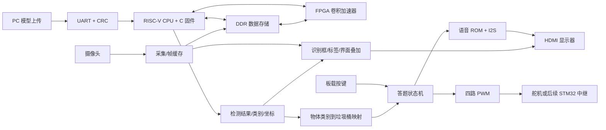

# 技术文档编写要点

## 1. 系统结构

实现平台为紫光同创 Logos2 PG2L100H（FBG676）FPGA。FPGA 内包含 RV32IM RISC-V CPU、卷积加速器、DDR 数据通路、摄像头采集、HDMI 图像显示及音频输出、按键与四路舵机控制。程序不是纯 C，也不是只有 Verilog：CPU/加速器/显示和外围由 Verilog/SystemVerilog 构成，C 固件运行于 FPGA 内部 CPU，Python 用于 PC 端模型处理与串口上传。

## 2. AI 推理链路

查阅 `source/yolo/software/platform_main.c`、`source/yolo/software/yolo_runtime.c`、`source/yolo/software/yolo_decode.c`，以及编号 040~051 的 RTL。说明图像输入、内存布局、卷积加速、算子调度、检测头解码、筛选和检测结果提交。PC 端 `../../extensions/yolo/scripts/board_loader.py` 定义模型写入、板端 CRC 检查、单帧摄像头推理和自主运行命令。

`source/yolo/model/graph.json`、同目录的 `memory_map.json`、`deployment_model.h` 和 `model.bin` 保留实际网络与部署描述。模型当前是 biodegradable / cardboard / glass / metal / paper / plastic 六类；业务映射将第 0 类作为厨余，将第 1~5 类作为可回收。四种 UI 桶色或四种标签不等于模型训练了四种垃圾大类，不能宣称有害和其他类已具备识别能力。

性能数值必须引用对应版本、时钟和测量记录。历史约 1 秒/帧的实验不应直接当作当前 v3 的稳定性能。最近烧录检查只做了两次摄像头推理，结果为空；不能据此给出准确率或长期稳定性结论。

## 3. 识别框与界面

查阅编号 049 视频前端及 052 顶层，比较 v3 与 v4。v4 后续源码加入中文类别标签，12×12 点阵按 2 倍显示为 24×24 像素，包含类别底色、屏幕边缘处理和显示叠加次序。识别框保存/清除逻辑应结合该文件的结果有效、超时及跨时钟域代码说明；不要把源码中的目标行为写成当前已烧录 v3 的显示验收结果。

白色标题栏在 `source/extensions/business/application/rtl/light_split_video.sv` 与同目录 `ui_light_panel.sv`；显示层级由顶层视频信号接线共同决定，只看面板模块不足以说明框是否盖过标题。v4 尚未产出位流。

## 4. 答题、按键与舵机

业务桶码/按键定义为 1=绿色厨余、2=红色有害、3=灰色其他、4=蓝色可回收。正常模式中，识别结果锁存为本轮答案，播提问语音，等待按键；答对/答错播放相应语音，两种情况均打开正确答案对应桶。开盖保持由 PWM 状态反馈管理；5 秒后关闭，普通模式回到等识别状态。固定答案诊断模式有单独参数，不应写成正式流程。

FPGA `source/extensions/business/application/rtl/servo_pwm4.sv` 的周期是 20 ms，正常脉宽 0°=0.5 ms、90°=1.5 ms；默认保持 250 帧≈5 秒。实例的 `REVERSED_MASK` 对开关脉宽进行交换，不改变 50 Hz 周期。空闲也持续发脉冲，因此 STM32 不能仅以“有没有 PWM”判断开盖，必须解码脉宽。

实际烧录的 v3 局部顶层清楚写出：

| 物理通道 | FPGA 球号 | 标准子卡参考针位 | v3 桶色 | 空闲/打开高电平 |
| --- | --- | --- | --- | --- |
| 0 | U16 | J3.27 | 绿 | 1.5 ms / 0.5 ms |
| 1 | U15 | J3.28 | 红 | 0.5 ms / 1.5 ms |
| 2 | AC26 | J3.29 | 灰 | 1.5 ms / 0.5 ms |
| 3 | AB26 | J3.30 | 蓝 | 0.5 ms / 1.5 ms |

FPGA 约束为 LVCMOS33。排针位置是历史标准子卡标注，无编号转接板应以实际连通关系为准。外接 STM32 和舵机电源必须与 FPGA 共地。

STM32 快照为 STM32F103C8T6 工程：PB12~PB15 输入，PA0~PA3 / TIM2_CH1~4 输出，TIM3 采样输入。当前代码的颜色注释与掩码未和 v3 对齐，不得直接引用旧 STM32 接线表作为当前板上最终接线。技术文档可以解释中继思路，但不能写为已经完成联调。

## 5. 音频

语音源素材见 `source/extensions/business/application/assets/audio`，转换后的 PCM ROM 及分银行文件见 `source/extensions/business/application/assets/audio_rom`，转换工具见 `source/extensions/business/application/tools/make_voice_rom.py`、同目录 `make_voice_banks.py`。播放器读 ROM，I2S 模块产生 BCLK/LRCLK/DATA，MS7210 初始化使音频进入 HDMI，显示器再负责音频输出。USB 供电音箱不代表音频从 USB 传入 FPGA。答题状态机的素材编号需要与播放器映射一起说明。

## 6. 构建与验证证据

目标器件和约束见 Tcl、`source/yolo/sources/camera.fdc`。本包提供路由后 timing summary；可说明该报告对应的具体 v3 构建，不得将其扩大为所有后续修改都时序通过。v4 的 PDS 日志显示在许可证检查阶段失败、未进入综合，因此不存在 v4 位流或下载成功证据。

`variants/v3_programmed_reference/最近重新烧录记录` 提供 JTAG、模型 CRC 和推理命令结果。记录显示 SRAM 下载，不是 Flash 固化；模型也经串口装载。因此开机自启动是另一个需要实现并验证的项目，不能写为已具备。

本包中的 testbench 和测试脚本可以用于说明验证方法；此次整理只验证文件完整性，没有重新运行全部 RTL 仿真、Keil 构建或硬件验收。历史文档内的“全部完成”“默认测试模式”等结论均须重新对照当前版本。
